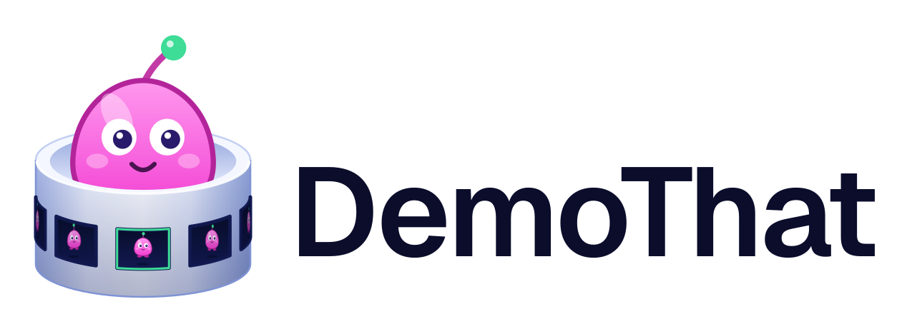

<h1 align="center">
  <picture>
    <source media="(prefers-color-scheme: dark)" srcset="docs/assets/brand/logo-horizontal-on-dark.svg" />
    
  </picture>
</h1>

<p align="center">
  <strong>Record your screen, let DemoThat auto-zoom the action, and publish a shareable clip.</strong><br />
  <sub>Free and open source · cinematic pan-and-zoom, with no manual keyframing.</sub>
</p>

<p align="center">
  <a href="https://github.com/getwithashish/DemoThat/actions/workflows/checks.yml"></a>
  <a href="https://github.com/getwithashish/DemoThat/actions/workflows/release.yml"></a>
  <a href="LICENSE"></a>
  <a href="https://nodejs.org/en/about/previous-releases"></a>
</p>

---

## 🎥 Demo


## ✨ What it does

- **Flexible capture** — record the full screen, a window, or a custom region, with optional webcam and microphone.
- **Cinematic mouse tracking** — follows your mouse and clicks, generating smooth pan-and-zoom effects with no manual keyframing.
- **Visual editor** — trim on a timeline, then style with backgrounds, frames, shadows, and reusable presets.
- **Instant aspect ratios** — switch between 16:9, 9:16 (Shorts/TikTok), and 1:1 (Instagram) in one click.
- **Caption cleanup** — transcribes the audio and removes filler words (um, uh, ...) from the captions.
- **High-quality export** — export to MP4 or GIF at up to 2K.
- **Publishing** — publish a finished clip as a landing page or embed through the DemoThat cloud service.

Some features (credits, cloud upscaling, publishing, Pro licensing) talk to a DemoThat API. The app ships pointing at the production API; see [Working against a local API](#working-against-a-local-api) to run it against a mock instead.

## ✅ Prerequisites

- **Node.js 22** (`engines` pins `>=18 <=22`). Use 22, not 24: the `postinstall` step (`electron-builder install-app-deps`) fails on Node 24. CI and the release workflow both pin 22.
- **FFmpeg binaries** for your OS, placed under `binaries/<os>/` (see [Install](#install)).
- **Platform build tooling** for the native optional dependencies:
  - **Windows:** [Build Tools for Visual Studio 2022](https://visualstudio.microsoft.com/visual-cpp-build-tools/) with the "Desktop development with C++" workload, and Python 3.8 on `PATH`.
  - **macOS:** Xcode Command Line Tools, and Python 3.8 on `PATH`.
  - **Linux:** X11 and Wayland both work; Wayland capture needs `xdg-desktop-portal` and PipeWire (default on recent GNOME, KDE, and Sway installs).

The repo ships a `package-lock.json`, so use **npm**.

## 📦 Install

```bash
git clone https://github.com/getwithashish/DemoThat.git
cd DemoThat
npm ci
```

`npm ci` runs `postinstall`, which rebuilds native app dependencies and patches Electron's `Info.plist`.

FFmpeg is not vendored; download it into `binaries/<os>/`:

```bash
# Linux
wget https://github.com/tamnguyenvan/screenarc-assets/releases/download/v0.0.1/ffmpeg-linux-x64 -O binaries/linux/ffmpeg && chmod +x binaries/linux/ffmpeg

# macOS (Apple Silicon)
wget https://github.com/tamnguyenvan/screenarc-assets/releases/download/v0.0.1/ffmpeg-darwin-arm64 -O binaries/darwin/ffmpeg-arm64 && chmod +x binaries/darwin/ffmpeg-arm64

# macOS (Intel)
wget https://github.com/tamnguyenvan/screenarc-assets/releases/download/v0.0.1/ffmpeg-darwin-x64 -O binaries/darwin/ffmpeg-x64 && chmod +x binaries/darwin/ffmpeg-x64

# Windows
wget https://github.com/tamnguyenvan/screenarc-assets/releases/download/v0.0.1/ffmpeg.exe -O binaries/windows/ffmpeg.exe
```

## 🚀 Run

```bash
npm run dev       # Vite dev server with HMR and the Electron shell
```

## 🏗️ Build

```bash
npm run build        # typecheck (tsc) + Vite production build into dist/ and dist-electron/
npm run dist:linux   # packaged Linux installers (AppImage, deb, rpm, zip)
npm run dist:win     # packaged Windows installer (NSIS)
npm run dist:mac     # packaged macOS dmg + zip (universal)
```

Packaging runs `tsc`, the Vite build, and then `electron-builder` (configured by the `build` block in `package.json`). The Linux `dist:*` scripts compile the native cursor helper first via `build:helper`. The `publish-*` scripts are for maintainers pushing release assets.

## 🧰 Scripts

| Script                                                      | What it does                                                                                                                            |
| ----------------------------------------------------------- | --------------------------------------------------------------------------------------------------------------------------------------- |
| `dev`                                                       | Start Vite + Electron in development with HMR.                                                                                          |
| `build`                                                     | Clean, typecheck (`tsc`), and run the Vite production build.                                                                            |
| `clean`                                                     | Remove `dist/` and `dist-electron/`.                                                                                                    |
| `preview`                                                   | Serve the built renderer with `vite preview`.                                                                                           |
| `test` / `test:watch`                                       | Run the Vitest suite once / in watch mode.                                                                                              |
| `lint` / `lint:fix`                                         | ESLint over `ts`/`tsx` (zero warnings) / auto-fix.                                                                                      |
| `format` / `format:check`                                   | Prettier write / check.                                                                                                                 |
| `build:helper`                                              | Compile the native cursor helper (`scripts/build-cursor-helper.sh`).                                                                    |
| `dist`                                                      | Full packaged build for the current platform.                                                                                           |
| `dist:linux` / `dist:win` / `dist:mac`                      | Packaged builds per platform (`dist:appimage`, `dist:deb`, `dist:rpm`, `dist:zip`, `dist:flatpak`, `dist:mac-arm64` target one format). |
| `publish-linux-app` / `publish-win-app` / `publish-mac-app` | Packaged build plus upload to the current GitHub release.                                                                               |
| `contract:check`                                            | Verify the vendored API contract version is pinned and consistent.                                                                      |
| `contract:types`                                            | Regenerate `shared/api-types.ts` from `contract/openapi.yaml`.                                                                          |
| `patch:electron-info-plist`                                 | Apply the macOS `Info.plist` patch (also runs in `postinstall`).                                                                        |
| `postinstall`                                               | Rebuild native deps and patch `Info.plist`.                                                                                             |

## 🗂️ Project structure

| Path                                         | Contents                                                                                                        |
| -------------------------------------------- | --------------------------------------------------------------------------------------------------------------- |
| `src/`                                       | React renderer: recorder, editor, and renderer pages, Zustand store, UI components.                             |
| `electron/`                                  | Electron main process, preload bridge, and their unit tests.                                                    |
| `shared/`                                    | Framework-free TypeScript (captions, fillers, export, pricing, cloud plans) used by both processes, with tests. |
| `contract/`                                  | Pinned vendored copy of the DemoThat API OpenAPI contract plus generated types.                                 |
| `scripts/`                                   | Build, contract, and FFmpeg helpers, plus a mock API server.                                                    |
| `binaries/`                                  | Per-OS FFmpeg and cursor-helper binaries (not committed builds; fetched or compiled).                           |
| `native/`, `build/`, `resources/`, `public/` | Native helper source, electron-builder resources/icons, macOS entitlements, static assets.                      |
| `docs/`                                      | Development notes, project structure, and platform plans.                                                       |

## 🧪 Testing

```bash
npm test          # vitest run
npm run test:watch
```

The Vitest suite (`vitest.config.ts`) covers `electron/**`, `src/**`, and `shared/**`. Tests run in a plain Node environment with `electron` and `electron-log` stubbed, so they exercise the pure logic: caption/filler-word removal, transcript and subtitle handling, export codecs/resolutions/caps, upscale and cloud-job planning, pricing and publish cost, license token handling, and API config. No coverage threshold is configured, so no coverage number is claimed here.

## 🔌 Working against a local API

The API base URL is baked at build time and never committed. To point a development build at a backend, copy `.env.example` to `.env.development.local` (gitignored) and set `DEMOTHAT_DEFAULT_API_BASE_URL` in it; `npm run dev` then bakes that URL in. Without the file, development falls back to the local mock server. Production builds (`npm run dist:*`, the CI release workflow) get their URL from the `DEMOTHAT_PRODUCTION_API_BASE_URL` GitHub repository secret, which is then baked into the binary; the build refuses to proceed if that secret is unset (see vite.config.ts). A runtime `DEMOTHAT_API_BASE_URL` always wins over the baked value. For the local mock:

```bash
node scripts/mock-api-server.mjs          # listens on :8788 by default
npm run dev                               # no .env.development.local → local mock
```

`DEMOTHAT_FORCE_PRO=1` unlocks Pro features without a key for development. Server-side behaviour is out of scope for this repo; `scripts/mock-api-server.mjs` is the reference for what the app expects.

## 🛠️ Troubleshooting

### Screen recording on Linux (xdg-desktop-portal)

**Symptom** — screen capturing fails on a Wayland Linux desktop. You see a "could not access the screen" / "your desktop did not hand over the screen" error, or the screen-sharing dialog never appears while recording.

**Diagnosis** — the app asks for the screen through `xdg-desktop-portal`'s `ScreenCast` interface. When that interface is missing, Chromium logs messages like:

```
ERROR:screen_capture_portal_interface.cc: Failed to request session: GDBus.Error:
  No such interface "org.freedesktop.portal.ScreenCast" on object at path /org/freedesktop/portal/desktop
```

Check whether the portal is actually providing the backend you need:

```bash
journalctl --user --since "5 min ago" | grep -i portal
echo "$XDG_SESSION_TYPE $XDG_CURRENT_DESKTOP"
ls /usr/share/xdg-desktop-portal/portals/
```

Bad output — the desktop is **only** falling back to `gtk.portal` for every interface (FileChooser, Print, Notification, ...), with no `ScreenCast` or `Screenshot` entry. That means no `portals.conf` matched your desktop, so the portal fell back to GTK — and the GTK backend does not provide screen capture.

**Fix** — make sure the portal backend for your desktop is installed and running:

```bash
# GNOME:    sudo apt install xdg-desktop-portal-gnome
# KDE:      sudo apt install xdg-desktop-portal-kde
# Sway/wlr: sudo apt install xdg-desktop-portal-wlr
# Hyprland: sudo apt install xdg-desktop-portal-hyprland
```

Make sure PipeWire and WirePlumber are installed and running (the portal captures through PipeWire):

```bash
systemctl --user status pipewire wireplumber
```

If it still falls back to GTK, pin the backends explicitly. Create `~/.config/xdg-desktop-portal/portals.conf`:

```ini
[preferred]
default=gtk
org.freedesktop.impl.portal.ScreenCast=gnome
org.freedesktop.impl.portal.Screenshot=gnome
```

(Replace `gnome` with `kde`, `wlr`, or `hyprland` to match your desktop.)

Then restart the portal:

```bash
systemctl --user restart xdg-desktop-portal
```

**Verify** — re-run the journalctl check, filtered to the portal, and confirm a `ScreenCast` backend line appears and its service starts:

```bash
journalctl --user --since "5 min ago" | grep -iE "portal|screencast"
```

**Note** — on X11 this is not needed: tools such as FFmpeg's `x11grab`, SimpleScreenRecorder, or OBS's X11 capture work without the portal.

### Getting everything working on Wayland — the full checklist

The screen-sharing dialog is only the first step. On Wayland, three features need separate setup, and none of them is optional if you want the full experience:

1. **Start the app in a Wayland session.** Otherwise Electron runs under XWayland and screen capture may behave like X11 (or fail).

   ```bash
   ./DemoThat-<version>-linux-x64.AppImage --no-sandbox \
     --ozone-platform-hint=wayland \
     --enable-features=WaylandWindowDecorations,WebRTCPipeWireCapturer,GlobalShortcutsPortal
   ```

2. **Have a working ScreenCast portal** (see the section above). Without it the recording cannot start at all. On KDE: `sudo apt install xdg-desktop-portal-kde`; on GNOME: `xdg-desktop-portal-gnome`; on Sway/wlroots: `xdg-desktop-portal-wlr`. Confirm with `journalctl --user | grep -i screencast`.

3. **Give the app read access to your mouse** — this is what makes click effects (click sounds and auto-zoom regions) work. Wayland has no API for click events, so the app reads them from the kernel directly, and that requires a udev rule. Recording works without it, but you get no clicks.

   Create `/etc/udev/rules.d/70-demothat-mouse.rules`:

   ```ini
   KERNEL=="event*", SUBSYSTEM=="input", ENV{ID_INPUT_MOUSE}=="1", ENV{ID_INPUT_KEYBOARD}!="1", TAG+="uaccess"
   KERNEL=="event*", SUBSYSTEM=="input", ENV{ID_INPUT_TOUCHPAD}=="1", TAG+="uaccess"
   ```

   Then reload and trigger the rules:

   ```bash
   sudo udevadm control --reload-rules && sudo udevadm trigger --subsystem-match=input
   ```

   Log out and back in (or reboot) so the access takes effect. The app's log tells you the outcome: `clicks on` means the mouse is readable; `clicks off` (or the udev hint in the log) means it is not.

   **A click is a physical press, not a tap.** The app reads button events from the kernel the same way system input does. On a click-pad, a light tap is often consumed as a gesture (tap-to-click) and never reaches the kernel as a button press, so no click is recorded. Press the click-pad down to the tactile click — a real mouse click always works. If hands-free tap-to-click is your default and you want every tap to be a click, a physical mouse is the reliable choice.

4. **(If they matter to you) global hotkeys.** The recorder's default shortcut keys need the shortcut portal (`GlobalShortcutsPortal` above) and a desktop that implements it — GNOME 46+ or KDE 6+. Without it the app logs a warning and the recorder's buttons still work.

## 🤝 Contributing

1. Fork the repo and create a descriptive branch: `feature/your-feature` or `fix/issue-number`.
2. Make your change; verify `npm run dev` still works and `npm test` passes.
3. Commit using [Conventional Commits](https://www.conventionalcommits.org/) (e.g. `feat: add webcam overlay`). Releases are automated from these messages.
4. Run the gates locally before pushing: `npm run lint`, `npm run format:check`, `npx tsc --noEmit`, `npm test`.
5. Open a pull request against `main` and fill in the PR template. PRs are squash-merged.

CI (`.github/workflows/checks.yml`) runs on every pull request and push to `main`: contract-version check, ESLint, Prettier check, typecheck, tests, and a diff check that `shared/api-types.ts` is regenerated from the pinned contract. A change that fails any of these cannot merge.

Commits use the [Conventional Commits](https://www.conventionalcommits.org/) types (`fix`/`perf` → patch, `feat` → minor, `feat!` or `BREAKING CHANGE:` → major; `docs`, `chore`, `refactor`, `test`, `ci`, `style` produce no release). On merge to `main`, `.github/workflows/release.yml` runs semantic-release and, when a release is cut, builds and attaches artifacts for Linux, Windows, and macOS.

See [CONTRIBUTING.md](CONTRIBUTING.md) and [CODE_OF_CONDUCT.md](CODE_OF_CONDUCT.md).

## 📜 License

DemoThat is licensed under the [GNU General Public License v3.0](LICENSE) (GPL-3.0).

- Copyright (C) 2025 Tam Nguyen (original ScreenArc)
- Copyright (C) 2026 Ashish Sam (modifications in DemoThat)

DemoThat is a fork of [ScreenArc](https://github.com/tamnguyenvan/screenarc) by Tam Nguyen, modified and maintained by Ashish Sam; original copyright notices are retained as required by the GPL, and the complete corresponding source for every release is available in this repository.
